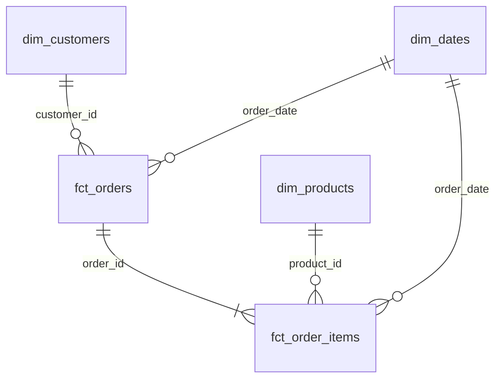
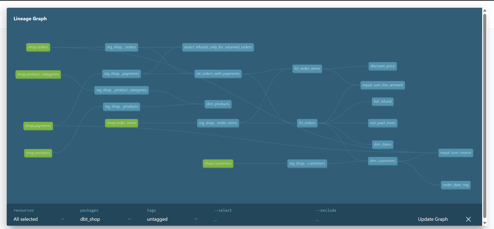

# store_hse

## Модель данных

### ER-диаграмма

### Витрины

1. fct_orders

Зернистость: заказ. Отвечает на вопрос "какая сумма заказов и количество подтверждённых успешных покупок?"

2. fct_order_items

Зернистость: товар в заказе. Отвечает на вопрос "Какие товары чаще заказывают? Какие товары покупают на наибольшую сумму?"

3. dim_customers

Зернистость: клиент (включая не купивших). Отвечает на вопрос: "Что чаще заказывают первым заказом? Через какое время после регистрации совершается 1 заказ?"

4. dim_products

Зернистость: товар. Отвечает на вопрос: "Какие бренды и категории чаще возвращают/покупают?"

5. dim_dates
Зернистость: день. Отвечает на вопрос: "В какое время суток/ дни недели/ месяцы самые активные продажи"? 

### Хранение в Greenplum

| Витрина | Настройка | Почему?|
| :--- | :--- | :--- |
| `fct_orders` | `distributed_by='order_id'`, `orientation='column'` | Большая таблица, в которой ключ `order_id` используется для JOIN с другими таблицами. Хранение по столбцам, чтобы не читать ненужные строки при работе с колонками. |
| `fct_order_items` | `distributed_by='order_id'`, `orientation='column'` | Ключ тот же, что и `fct_orders`: `order_id`. При JOIN не будет пересылки данных и это будет быстрее. |
| `dim_customers` | `distributed_replicated=true` | Это небольшое измерение. Засчёт этой настройки JOIN с фактами будет без пересылки строк. |
| `dim_products` | `distributed_replicated=true` | Это небольшое измерение. Засчёт этой настройки JOIN с фактами будет без пересылки строк. |
| `dim_dates` | `distributed_replicated=true` | Это небольшое измерение. Засчёт этой настройки JOIN с фактами будет без пересылки строк. |

### Тесты

1. Generic-тесты: `unique` для первичных ключей, `not_null`, `relationships`, `non_negative` для цен, скидок, товаров в заказе.
2. Singular-тесты: 
  - Проверка, что сумма заказа равна сумме его позиций
  - Сумма подтвержденных покупок совпадает с суммой по source
  - Проверка, что при возврате возвращается необходимое количество денег
  - Проверка, что по подтверждённому товару не списали больше его стоимости (!в этом тесте есть ошибка: в заказе 113 сумма к оплате 200, а оплачено 400. По какой-то причине оплата за заказ прошла дважды, указано два успешных платежа в `successful_payments_count`)
  - Проверка, что дата первого заказа не раньше даты регистрации
  - Проверка, что скидка не больше, чем цена товара

###
Доп. задание
В проект подключен пакет dbt_utils. Для генерации ключа `order_item_id` в fct_order_items используется функция dbt_utils.generate_surrogate_key

### Граф 

